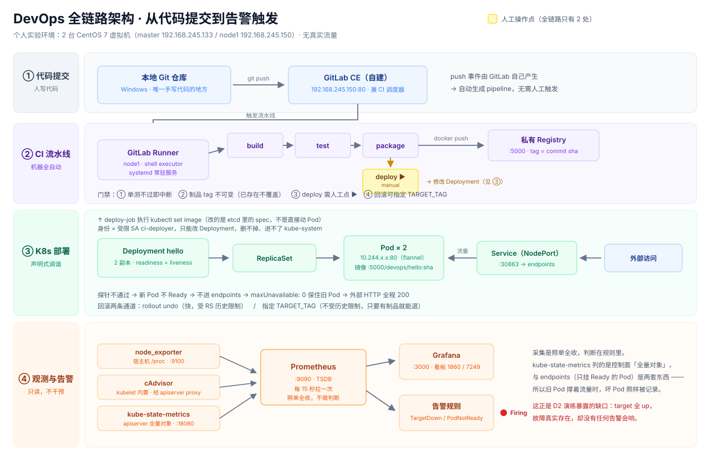

# Week7-D2：全链路架构图

> 一张图覆盖 W1~W6 的全部产出。目标不是"画得好看"，是**能指着图把整条链讲完，并且每个点都能被追问**。



---

## 一、这张图解决什么问题

前面六周做了五个实验：Docker、Jenkins、GitLab CI、K8s、Prometheus。
**它们是五段孤立的**——单独讲每一段都行，但被问"你做过什么"时，容易讲成工具清单。

这张图把它们压成**一条有方向的链**：

```
代码提交 → CI 构建 → 镜像入库 → K8s 部署 → 观测告警
```

**一条链的价值**：每个环节都能回答"上一步产出什么、下一步消费什么"。
比如「镜像入库」的产出是 `:5000/devops/hello:7d75d679`，K8s 部署消费的就是这个 tag——
**回滚能成立，全靠这个 tag 不可变**。这种因果关系，单讲工具讲不出来。

---

## 二、四层分区，逐层讲

### ① 代码提交（人写代码）

| 项 | 内容 |
|---|---|
| 包含 | Windows 本地 Git 仓库 → `git push` → GitLab CE（`192.168.245.150:80`） |
| 关键点 | GitLab 既是 Git 服务器，**又是 CI 调度器**——push 事件是它自己产生的，所以能自动触发流水线 |
| 对照 | 推镜像到 registry **不会**触发部署，因为 registry 只是被动存储，没有事件能力 |

**这层的坑（真实踩过）**：`git status` 显示的 `ahead 6` 是假象——之前用带凭据的完整 URL 推送，没走 `origin` 这个 remote，本地 `origin/main` 指针陈旧。要确认真实状态用 `git ls-remote origin refs/heads/main`。

### ② CI 流水线（机器全自动，除了一处）

| 阶段 | 干什么 | 失败会怎样 |
|---|---|---|
| `build` | 写 `dist/build-info.txt`（含 commit sha），作为 artifact 传下去 | 后续全停 |
| `test` | `scripts/test.sh` 检查文件存在、grep 页面字符串 | **单测门禁**，不过则后续全停 |
| `package` | 检查 tag 是否已存在 → `docker build` 双 tag → `docker push` | **制品不可变**：tag 已存在就跳过，不覆盖 |
| `deploy` | `kubectl set image` + `rollout status` + 冒烟 | 超时变红，但**线上不受影响**（见第 ③ 层） |

**四道门禁**（这是 W3 的产出，也是这层最值钱的部分）：

1. 单测不过即中断
2. 制品 tag 不可变（已存在不覆盖）
3. deploy 需人工点 ▶（`when: manual`）
4. 回滚可指定 `TARGET_TAG`

**两个隐藏设计**（都是踩坑换来的，被问到时能加分）：

| 设计 | 为什么 |
|---|---|
| `GIT_DEPTH: 0` | node1 上 git 1.8.3.1 + Runner 默认浅克隆 → 第二次构建起必报 `expected shallow list`。`0` 是**禁用浅克隆的开关值**，不是"深度 0" |
| `curl ... \|\| true` + 重试 6 次 | Shell executor 开着 `set -e`，curl 非 0 会让脚本立即中止；`rollout status` 成功 ≠ 流量可达，iptables 收敛有秒级延迟 |

### ③ K8s 部署（声明式调谐，没有人敲命令）

**这层最重要的一句话**：`kubectl set image` **只改了 etcd 里的 spec**，剩下全是控制器自己做的。

```
Deployment controller 发现模板变了
  → 新建 ReplicaSet（REV 递增）
  → RS controller 建 Pod
  → kubelet 从 registry 拉镜像
  → readinessProbe 通过 → Pod Ready → 进 endpoints
  → 缩掉旧 RS 的副本
```

**为什么坏版本不会影响用户**（这是 D2 演练验证过的）：

```
探针不通过 → 新 Pod 永远不 Ready
  → 不进 endpoints（流量只给 Ready 的 Pod）
  → maxUnavailable: 0 不许删旧 Pod
  → 旧 Pod 继续服务 → 外部 HTTP 全程 200
  → 只有 deploy-job 因 90 秒超时变红
```

**两条回滚通道，各自什么时候失效**：

| 通道 | 命令 | 优势 | 失效条件 |
|---|---|---|---|
| A | `kubectl rollout undo` | 秒级，不用记 tag | 只能退到 `revisionHistoryLimit` 内的版本；RS 被清理就退不回去 |
| B | `kubectl set image ...:TARGET_TAG` | 不受 RS 历史限制 | 需要 registry 里那个 tag 还在（所以 tag 不可变是前提） |

### ④ 观测与告警（只读，不干预业务）

| 采集源 | 数据来自 | 提供什么 |
|---|---|---|
| `node_exporter` | 宿主机 `/proc`（:9100） | 机器级 CPU / 内存 / 磁盘 |
| `cAdvisor` | kubelet 内置，经 **apiserver proxy** 访问（10250 直连会 401） | 容器级资源 |
| `kube-state-metrics` | watch apiserver（:18080） | 对象状态：副本数、Pod 是否 Ready、重启次数 |

**数据流**：三个 exporter → Prometheus（每 15 秒拉一次，存 TSDB）→ Grafana 画图 / 规则求值 → `Firing`。

**告警规则（现在只有 2 条）**：

| 规则 | 表达式 | 抓什么 |
|---|---|---|
| `TargetDown` | `up == 0` | 采集目标挂了 |
| `PodNotReady` | `kube_pod_status_ready{condition="false",namespace="default"} == 1` | Pod 持续不 Ready |

---

## 三、全链路只有 2 个人工点

图右上角那个黄色标记，指的是：

| 人工点 | 为什么必须是人 |
|---|---|
| `deploy-job ▶` | **发布决策**——什么时候上线、上哪个版本，机器不该替人决定 |
| `rollback-job ▶` | **止损决策**——回滚意味着承认这次变更有问题，需要人判断 |

其余全是机器：构建、测试、推镜像、滚动、采集、告警。

> **这句话值得记住**：自动化不是"没有人"，是"人只出现在需要承担责任的地方"。

---

## 四、三个反直觉的点（被追问时的高频题）

### 1. `localhost:9090` 只在 node1 有效

Prometheus 装在 node1，从 master 上 `curl localhost:9090` 会静默失败（`curl -s` 吞掉错误）。
跨机要写 `http://192.168.245.150:9090`。

**为什么值得说**：这类"命令没错但环境不对"的坑，是排障时最耗时间的一类。

### 2. 旧 Pod 撑流量时，监控照样能发现新 Pod 不 Ready

这是 D2 里被问住的那个问题，答案是：

> Prometheus 不"决定去看哪个 Pod"，它拉的是 kube-state-metrics 暴露的**全量对象清单**。
> 那个清单是 watch apiserver 之后，把 etcd 里**所有** Pod 对象翻译出来的——
> 不需要 Pod Ready、不需要它进 endpoints。

| | 控制面（指标来源） | 数据面（流量） |
|---|---|---|
| 内容 | etcd 里**所有** Pod 对象 | endpoints 里**Ready 的** Pod |
| 坏 Pod 在不在 | ✅ 在 | ❌ 不在 |

**endpoints 决定"谁能接客"，kube-state-metrics 记录"谁存在、什么状态"。两套系统互不影响。**

### 3. 能采集 ≠ 能告警

D2 演练里：四个 target 全 `up`、`Firing` 数 = 0，但故障真实存在。

**因为原有规则只有 `up == 0`**——它只关心"能不能抓到数据"，不关心"数据说明什么"。
补 `PodNotReady` 之后才响。

> 这条是整张图里最有价值的认知：**监控的覆盖范围 = 规则的覆盖范围，不是采集的覆盖范围。**

---

## 五、1 分钟可复述版本

> 我在两台 CentOS 7 虚拟机上搭了一条完整的 DevOps 链路。
>
> **入口是 Git**：本地改代码 push 到自建 GitLab，push 事件自动触发流水线。
>
> **CI 是 GitLab CE + Shell Runner**，四个阶段：build 出构建信息、test 跑单测门禁、package 构建镜像推到私有 registry 并用 commit sha 打 tag、deploy 是人工审批的。
>
> **制品 tag 用 sha 不用 latest**，因为 latest 会变，sha 不会——这是回滚能成立的地基。
>
> **部署是 K8s**：CI 用一个只能改 Deployment 的受限 ServiceAccount 执行 `kubectl set image`，后面全是控制器自动做的——建 RS、起 Pod、探针通过后进 endpoints、再缩旧副本。
>
> **监控是 Prometheus + Grafana**，三个采集源：node_exporter 看机器、cAdvisor 看容器、kube-state-metrics 看对象状态。
>
> **最后我做了一次故障演练**：故意发一个"容器正常运行但探针不通"的坏版本，验证了三件事——流水线变红、外部 HTTP 全程 200、以及**原有告警规则一条都没响**，因为规则只覆盖了采集层。补了 `PodNotReady` 之后才抓到，回滚用的是按 tag 回退那条通道。

---

## 六、30 秒极简版（自我介绍用）

> 我搭过一条从代码提交到监控告警的完整链路：GitLab CI 自动构建并把镜像推到私有 registry，用 commit sha 做不可变 tag；CI 用受限权限的 ServiceAccount 操作 K8s Deployment，靠探针和 `maxUnavailable: 0` 保证坏版本不影响线上；监控用 Prometheus 接三类指标源。我做过一次故障演练，验证了坏版本会被探针拦住、用户全程无感，也发现并补上了告警覆盖的缺口。

---

## 七、五个高频追问，怎么答

| 追问 | 答法要点 |
|---|---|
| **为什么用 sha tag 不用 latest？** | latest 会变，回滚时不知道该退到哪个具体制品；sha 不可变，能精确定位。而且 tag 不可变是 package 阶段的门禁——已存在就不覆盖 |
| **探针拦住了，为什么流水线还会红？** | `rollout status --timeout=90s` 会一直等 Pod 就绪，超时就返回非 0。红是对的——**它反映"这次发布没成功"，而不是"服务挂了"**。这两件事必须分开看 |
| **`maxUnavailable: 0` 有什么代价？** | 滚动期间会短暂多占资源（先起新的再删旧的）。如果节点资源不够，新 Pod 会 Pending，发布卡住。所以要配合 `resources` 限制和节点容量规划 |
| **kube-state-metrics 和 cAdvisor 有什么区别？** | cAdvisor 回答"容器用了多少资源"，来自 kubelet；kube-state-metrics 回答"对象现在什么状态"，来自 apiserver。前者是数值，后者是状态 |
| **这套东西上生产还差什么？** | 差得多：单点（GitLab/Prometheus 都是单实例）、没有灰度、没有 Alertmanager 通知渠道、没有持久化存储、没有多副本控制面、没做备份。**实验环境验证的是机制，不是可靠性** |

---

## 八、边界（必须主动说清）

| 这是 | 这不是 |
|---|---|
| 2 台虚拟机的实验环境 | 生产环境 |
| 单地域、单集群、无真实流量 | 有 SLA、有用户、有值班 |
| 验证了"机制能跑通" | 验证了"扛得住" |

**对外表述只能是**："我在实验环境完整搭过并演练过一次全链路"，
**不能说**"我负责过生产 CI/CD 平台"。

---

## 附：图的文件位置

- 图：`docs/architecture.svg`（GitHub 可直接渲染）
- 本文：`notes/Week7-D2-全链路架构图.md`

改图直接编辑 SVG 的坐标即可，字体用系统字体族，GitHub / 本地浏览器都能正常显示。
